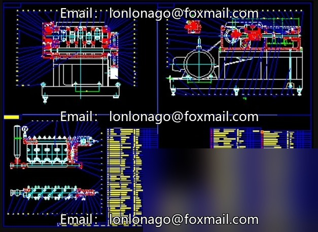
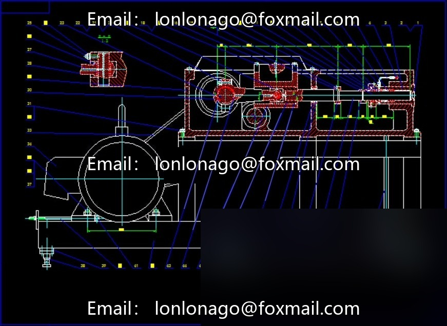
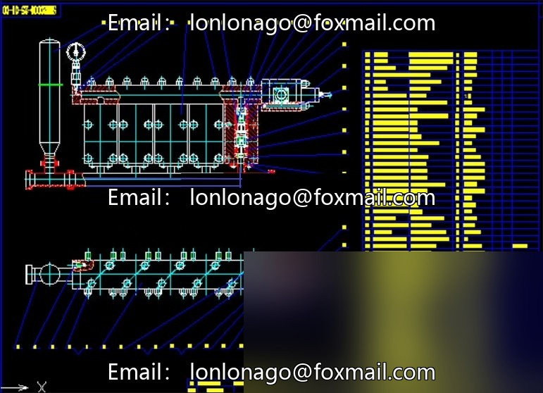

# Building beam bending machine design; building beam bending machine design drawing; building beam bending machine design CAD drawing; steel beam bending machine design;

## Body

Rib bending machine design; rib bending machine design drawings; rib bending machine design CAD drawings; rib bending machine CAD drawings.
423    drawings including assembly parts and individual components, which contain assembly drawings, drawings of two axes, drawings of gears, and drawings of upper and lower shells.

The design and CAD drawings cover steel bending machine designs, design plans, CAD drawings, and include assembly parts, assembly drawings, two-axis drawings, gear drawings, upper shell and lower shell drawings.

<!-- AI_ENRICHED -->

## Images

## Payment

Here is a pay link on Stripe ( https://buy.stripe.com/3cs8yP7sY87d0vu9AB ). Please contact me lonlonago@foxmail.com after funding $89, and I will send you a complete data files , thank you!

